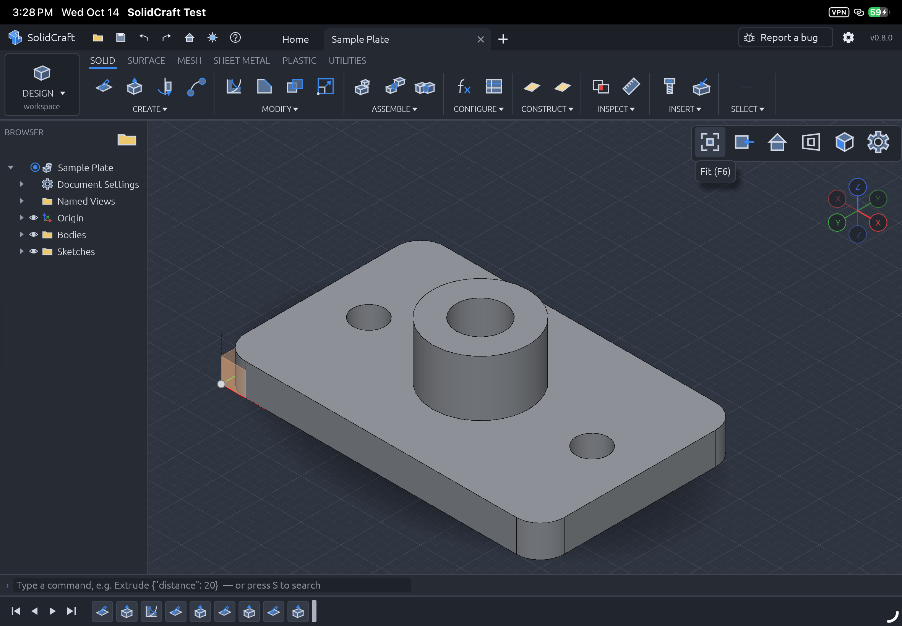
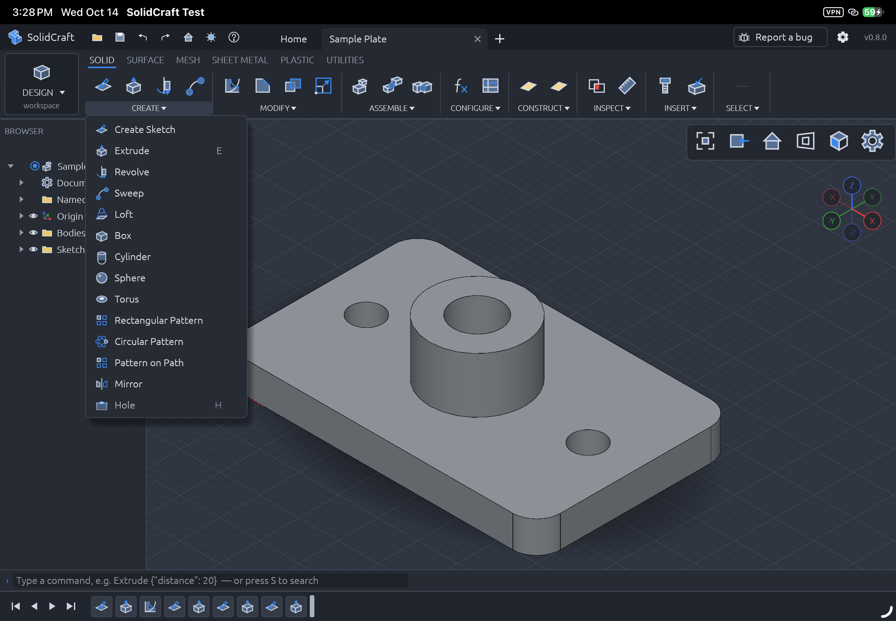
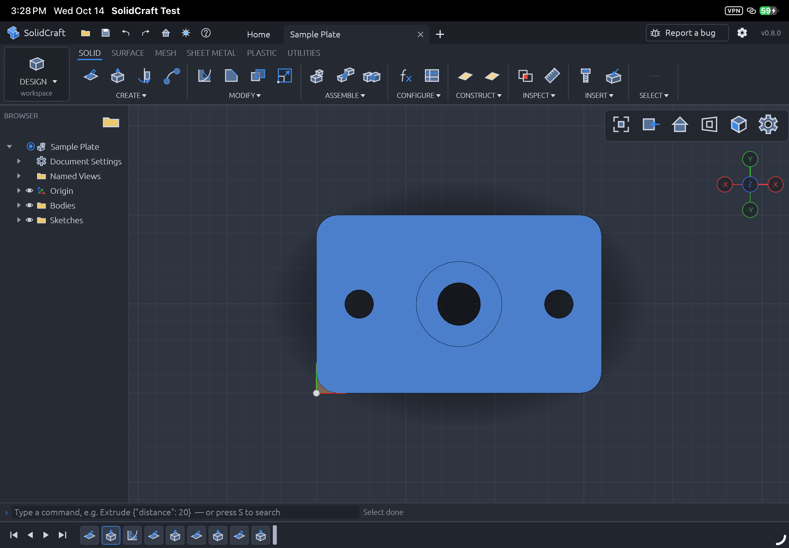
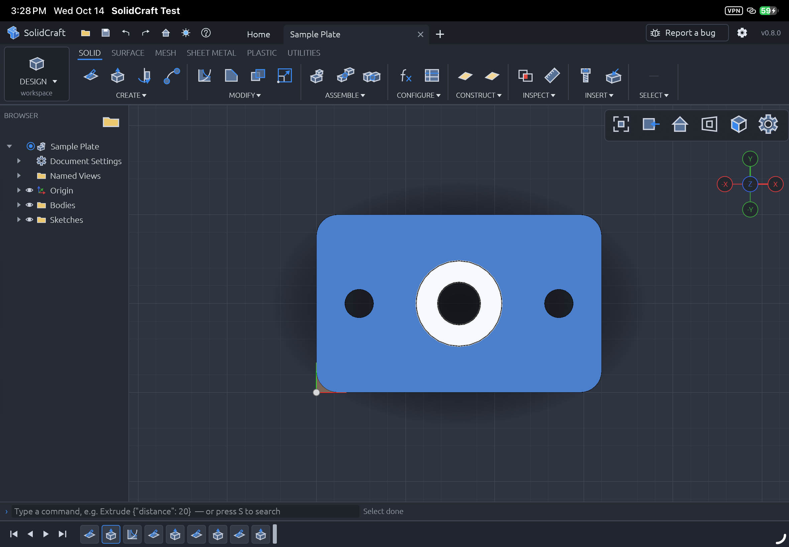
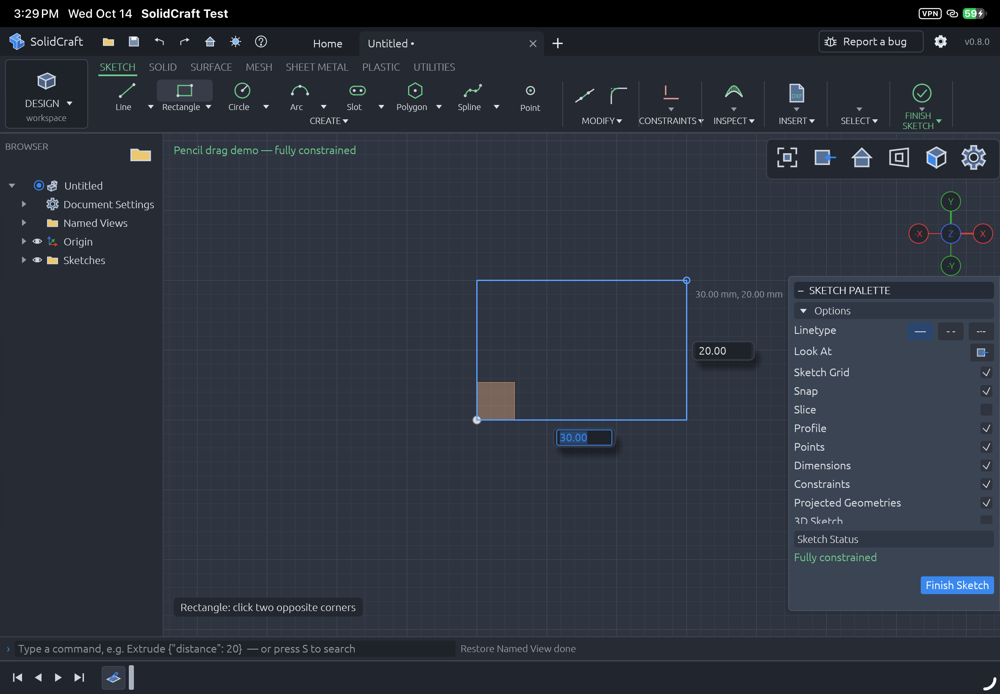
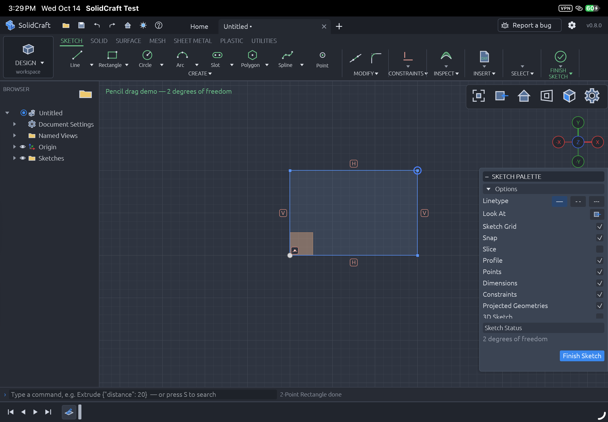
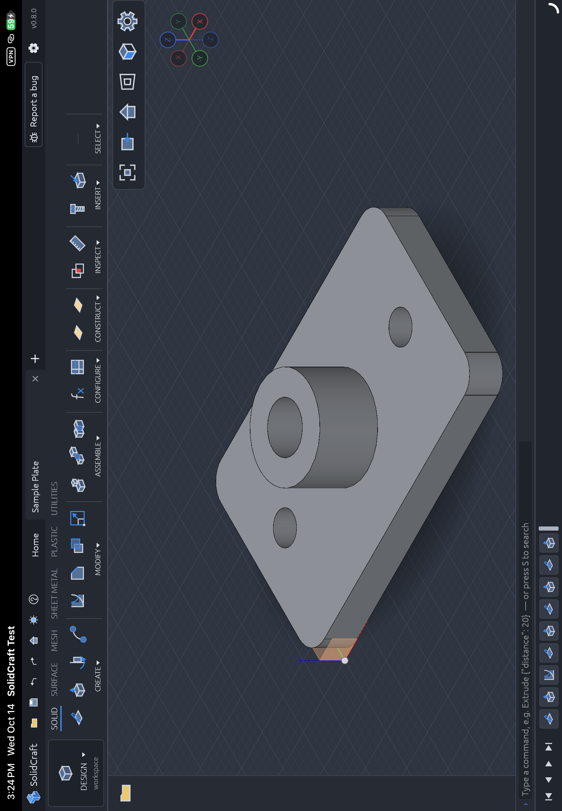
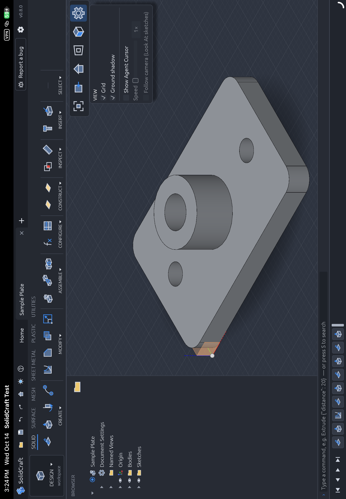
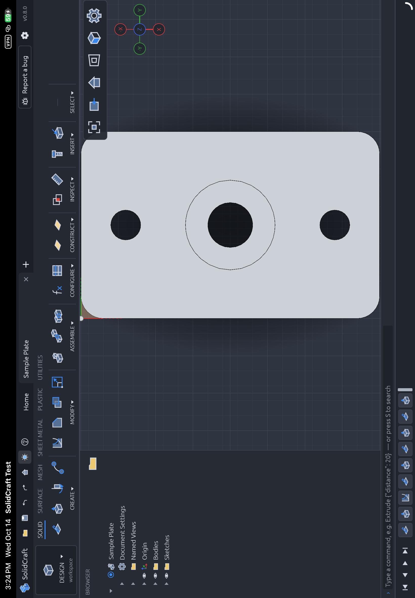

# iPad interface screenshots

Maintained in [cwallyman/solidcraft → ipad-solidcraft](https://github.com/cwallyman/solidcraft/tree/ipad-solidcraft). The duplicate standalone repository is archived.

Captured October 14, 2026 on the physical iPad Air 11-inch (M3), using source checkpoint `f2eaccf0`. These are screenshots of the real SwiftUI/WKWebView app rendering its bundled CAD engine. They show only the built-in public sample and a small generated demonstration sketch. The PNGs retain the original screen captures; no interface elements were composited or redrawn.

## How these were captured

The hover, dropdown, face-selection and sketch examples use a temporary DEBUG fixture through the existing `--workflow-test` callback. It injects contact/mouse events into the real input pipeline, explicitly selects the Pencil input source for selection/drawing, and pauses for native `devicectl` screenshots. The hover example invokes the existing Pencil hover cursor handler. These establish rendered UI states on the device, rather than independent proof of physical Pencil contact or hover hardware. The user separately confirmed physical Pencil hover works earlier in development.

The browser and view screenshots come from the physical-device XCTest `RuntimeTests/testFingerInterfaceBrowserResizeCollapseAndFaceAlignment`, which passed with zero failures in approximately 18 seconds. Those use XCTest finger gestures and native screenshot attachments. This is one passing focused test, not a full device-suite or full CI pass.

The fixture is excluded from the committed app source. Temporary capture attempts and diagnostic logs stay local. All images below were visually reviewed before publication. Screenshots are original project documentation under the repository's MIT OR Apache-2.0 license; displayed upstream SolidCraft UI retains its existing attribution.

## Gallery

### iPad workspace

The sample plate with the resized toolbar, upper-right view controls, and browser folder icon without the B overlay.

### Button-name hover label

The Fit (F6) tooltip is visible below the upper-right Fit control. The fixture calls the same Pencil hover cursor handler.

### Create dropdown open

Create exposes its commands below the toolbar.

### Second press closes the dropdown

The same Create trigger is pressed again and its menu closes.

### Multiple faces selected

Both the plate top and boss ring are selected in blue. The live engine reports two selected items.

### One face toggled off

The boss ring is deselected while the plate stays selected. Blue indicates selection; the white ring is the current hover highlight. Live selection count: one.

### Sketch drag preview

A 30 by 20 mm rectangle is previewed while the contact is held, with its inline dimension fields visible.

### Rectangle completed on release

Releasing the drawing contact creates the rectangle, its profile and constraint glyphs.

### Browser collapsed

The browser becomes a narrow rail with a plain folder icon and no B overlay.

### Browser resized

The browser divider has been dragged wider using a finger gesture from XCTest.

### Upper-right view settings

The view-settings popup opens beneath the upper-right controls.

### Face-aligned view

A finger double tap changes the sample to a face-normal view without changing the selection.

